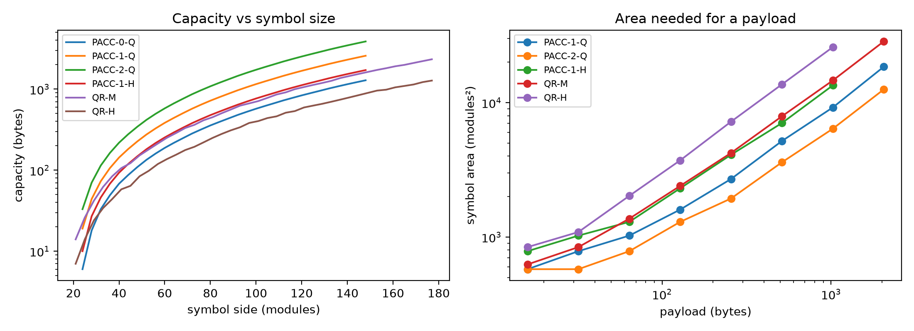
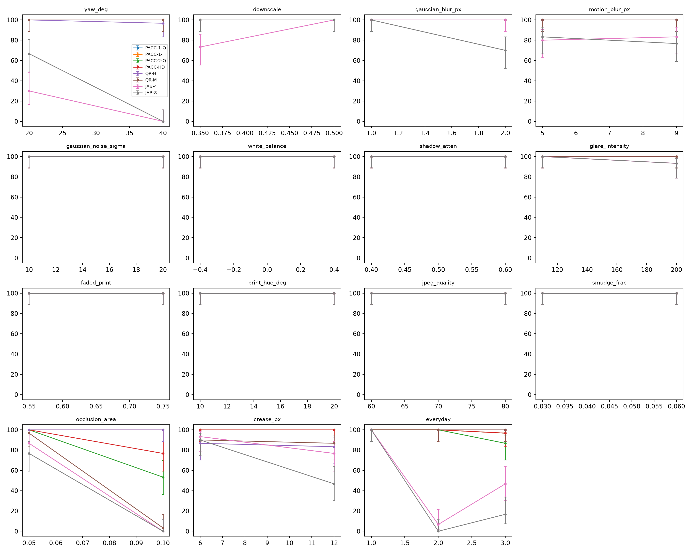
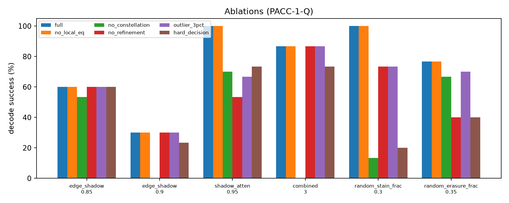
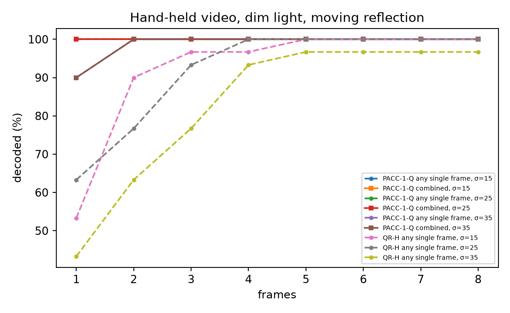
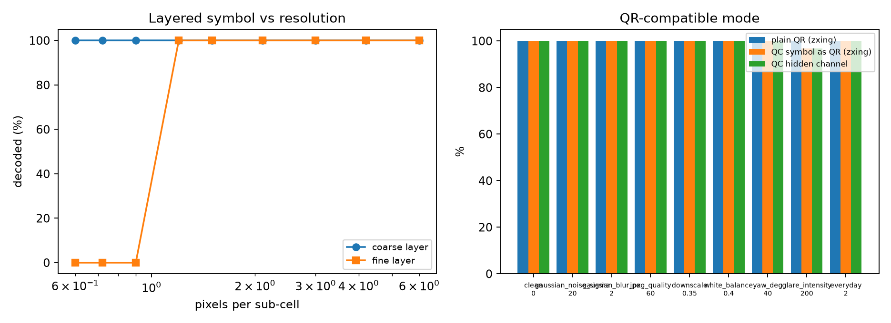

# PACC Benchmark Report

Generated 2026-11-24T22:06:19 · commit `59bdd77` · 30 trials per condition · protocol: everyday.

All results are from digital renders and simulated capture effects; they are not a substitute for print-and-camera measurements.

## N1 Capacity & density

Symbol side (modules) needed for a payload:

| payload (B) | PACC-1-Q | PACC-2-Q | PACC-1-H | QR-M | QR-H |
|---|---|---|---|---|---|
| 16 | 24 | 24 | 28 | 25 | 29 |
| 32 | 28 | 24 | 32 | 29 | 33 |
| 64 | 32 | 28 | 36 | 37 | 45 |
| 128 | 40 | 36 | 48 | 49 | 61 |
| 256 | 52 | 44 | 64 | 65 | 85 |
| 512 | 72 | 60 | 84 | 89 | 117 |
| 1024 | 96 | 80 | 116 | 121 | 161 |
| 2048 | 136 | 112 | None | 169 | None |

Area of PACC-1-Q relative to QR-H: 16 B → 0.69×, 32 B → 0.72×, 64 B → 0.51×, 128 B → 0.43×, 256 B → 0.37×, 512 B → 0.38×, 1024 B → 0.36×

## N2 Robustness at equal printed footprint

31 conditions × 30 paired trials; symbols scaled to the same printed width, placed at random offsets. Wilson 95% intervals in `n2_robustness.csv`.

| codec | mean success (%) |
|---|---|
| PACC-1-Q | 99.9 |
| PACC-1-H | 99.9 |
| PACC-HD | 99.1 |
| QR-H | 98.9 |
| PACC-2-Q | 98.1 |
| QR-M | 96.0 |
| JAB-4 | 82.9 |
| JAB-8 | 81.3 |

McNemar PACC-1-Q vs QR-H: significant difference (p < 0.05) in 0 of 31 conditions (`n2_mcnemar_pacc2_vs_qrh.csv`).

## N3 Decoder ablations

Mean success over: edge_shadow=0.85, edge_shadow=0.9, shadow_atten=0.95, combined=3, random_stain_frac=0.3, random_erasure_frac=0.35

| decoder variant | PACC-1-Q | PACC-2-Q |
|---|---|---|
| full | 75.6 | 68.3 |
| no_local_eq | 75.6 | 68.3 |
| no_constellation | 33.9 | 41.7 |
| no_refinement | 57.2 | 53.4 |
| outlier_3pct | 64.5 | 44.5 |
| hard_decision | 48.3 | 38.9 |

Everyday set: everyday=2, everyday=3, gaussian_noise_sigma=20, shadow_atten=0.6, glare_intensity=200, smudge_frac=0.06, faded_print=0.55, motion_blur_px=9

| decoder variant | PACC-1-Q | PACC-2-Q |
|---|---|---|
| full | 99.6 | 98.3 |
| no_local_eq | 99.6 | 98.3 |
| no_constellation | 99.6 | 98.3 |
| no_refinement | 99.6 | 98.3 |
| outlier_3pct | 99.6 | 98.3 |
| hard_decision | 99.6 | 98.3 |

## N4 Latency (Python reference)

| MCS | side | payload (B) | encode ms | decode ms |
|---|---|---|---|---|
| 0 | 24 | 6 | 0.6 | 12.6 |
| 0 | 36 | 49 | 1.2 | 15.0 |
| 0 | 48 | 109 | 1.9 | 16.7 |
| 0 | 64 | 217 | 3.9 | 24.5 |
| 0 | 80 | 356 | 5.3 | 27.5 |
| 0 | 100 | 572 | 10.5 | 97.1 |
| 0 | 124 | 893 | 13.2 | 114.7 |
| 0 | 148 | 1284 | 19.1 | 79.7 |
| 1 | 24 | 19 | 0.6 | 12.9 |
| 1 | 36 | 106 | 1.8 | 18.1 |
| 1 | 48 | 226 | 2.9 | 19.9 |
| 1 | 64 | 441 | 5.1 | 23.8 |
| 1 | 80 | 719 | 8.5 | 30.8 |
| 1 | 100 | 1151 | 13.3 | 83.3 |
| 1 | 124 | 1794 | 20.7 | 108.1 |
| 1 | 148 | 2576 | 32.2 | 81.4 |
| 2 | 24 | 33 | 0.8 | 14.7 |
| 2 | 36 | 163 | 2.0 | 16.9 |
| 2 | 48 | 343 | 3.7 | 20.3 |
| 2 | 64 | 666 | 6.7 | 28.8 |
| 2 | 80 | 1082 | 11.2 | 37.1 |
| 2 | 100 | 1730 | 18.3 | 93.0 |
| 2 | 124 | 2695 | 29.2 | 127.1 |
| 2 | 148 | 3868 | 38.4 | 101.6 |

The TypeScript decoder's grid decode is timed by `npm run test:pacc`.

## N5 Security envelope overhead

Payload 79 B.

| envelope | overhead (B) | N (KCMY, Q) | N (CUBE8, Q) | seal ms | open ms |
|---|---|---|---|---|---|
| plain | 0 | 36 | 32 | 0.0 | 0.0 |
| Ed25519 (embedded key) | 97 | 44 | 40 | 0.14 | 0.17 |
| Ed25519 (key id) | 73 | 44 | 36 | 0.19 | 0.23 |
| ML-DSA-44 (key id) | 2429 | 148 | 120 | 1.1 | 0.21 |
| passphrase (Argon2id p0) | 46 | 40 | 36 | 31.56 | 29.17 |
| HPKE X25519 | 53 | 40 | 36 | 0.23 | 0.21 |
| HPKE X-Wing (PQ) | 1141 | 104 | 88 | 0.3 | 0.56 |
| ML-DSA-44 + X-Wing | 3570 | None | 144 | 1.1 | 0.8 |

## N6 Multi-frame combining

Hand-held video in dim light with a reflection that moves from frame to frame. 'Any frame' is the chance that at least one single frame decodes (what every reader gets from video); 'combined' adds PACC's combination of frames that fail on their own.

| codec | noise σ | single frame | any frame ≤2 | any ≤4 | any ≤8 | combined ≤2 | combined ≤4 | combined ≤8 |
|---|---|---|---|---|---|---|---|---|
| PACC-1-Q | 15 | 100.0 | 100.0 | 100.0 | 100.0 | 100.0 | 100.0 | 100.0 |
| PACC-1-Q | 25 | 100.0 | 100.0 | 100.0 | 100.0 | 100.0 | 100.0 | 100.0 |
| PACC-1-Q | 35 | 90.0 | 100.0 | 100.0 | 100.0 | 100.0 | 100.0 | 100.0 |
| QR-H | 15 | 53.3 | 90.0 | 96.7 | 100.0 | — | — | — |
| QR-H | 25 | 63.3 | 76.7 | 100.0 | 100.0 | — | — | — |
| QR-H | 35 | 43.3 | 63.3 | 93.3 | 96.7 | — | — | — |

At the limit (PACC rate 4/5, heavy noise and a moving highlight; every single frame fails):

| noise σ | single frame (%) | ≤2 frames | ≤4 frames | ≤8 frames |
|---|---|---|---|---|
| 50 | 0.0 | 43.3 | 86.7 | 96.7 |
| 70 | 0.0 | 53.3 | 93.3 | 96.7 |
| 90 | 0.0 | 50.0 | 90.0 | 100.0 |
| 110 | 0.0 | 46.7 | 83.3 | 100.0 |
| 130 | 0.0 | 16.7 | 40.0 | 80.0 |

## N7 Layered symbols & QR-compatible mode

30 trials per row.

| px per sub-cell | coarse (%) | fine (%) |
|---|---|---|
| 6.0 | 100.0 | 100.0 |
| 4.2 | 100.0 | 100.0 |
| 3.0 | 100.0 | 100.0 |
| 2.1 | 100.0 | 100.0 |
| 1.5 | 100.0 | 100.0 |
| 1.2 | 100.0 | 100.0 |
| 0.9 | 100.0 | 0.0 |
| 0.72 | 100.0 | 0.0 |
| 0.6 | 100.0 | 0.0 |

| condition | plain QR read (%) | QC symbol read as QR (%) | hidden channel (%) |
|---|---|---|---|
| clean 0 | 100.0 | 100.0 | 100.0 |
| gaussian_noise_sigma 20 | 100.0 | 100.0 | 100.0 |
| gaussian_blur_px 2 | 100.0 | 100.0 | 100.0 |
| jpeg_quality 60 | 100.0 | 100.0 | 100.0 |
| downscale 0.35 | 100.0 | 100.0 | 100.0 |
| white_balance 0.4 | 100.0 | 100.0 | 100.0 |
| yaw_deg 40 | 100.0 | 100.0 | 100.0 |
| glare_intensity 200 | 100.0 | 96.7 | 96.7 |
| everyday 2 | 100.0 | 100.0 | 100.0 |

